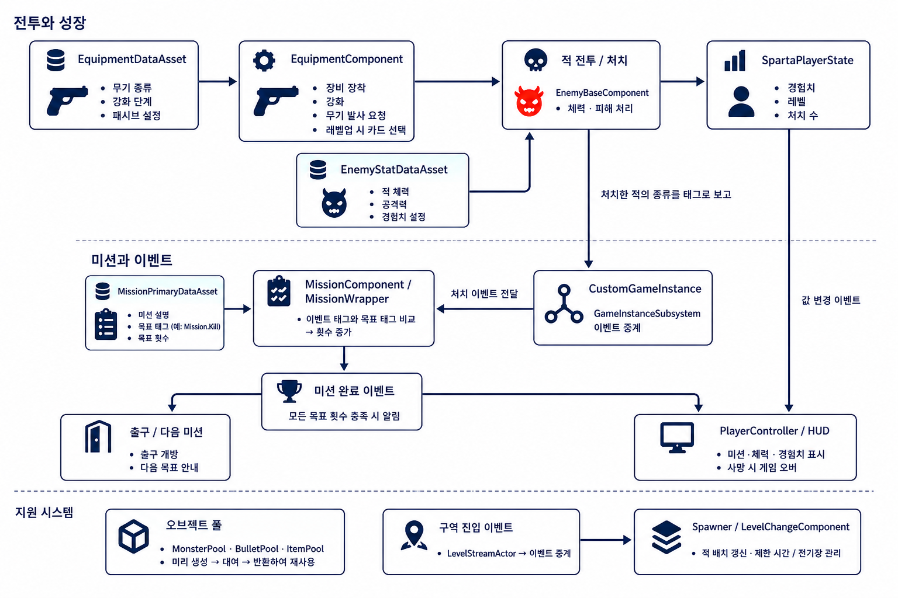
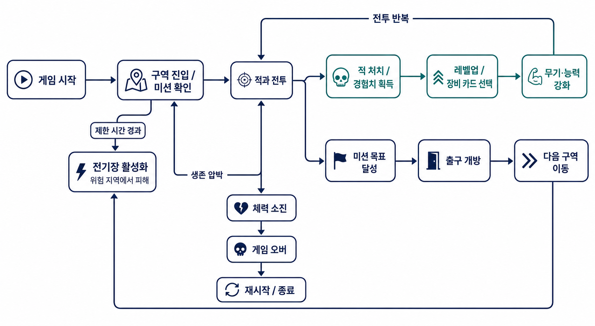
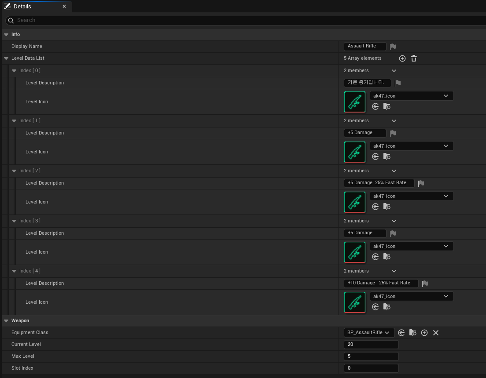
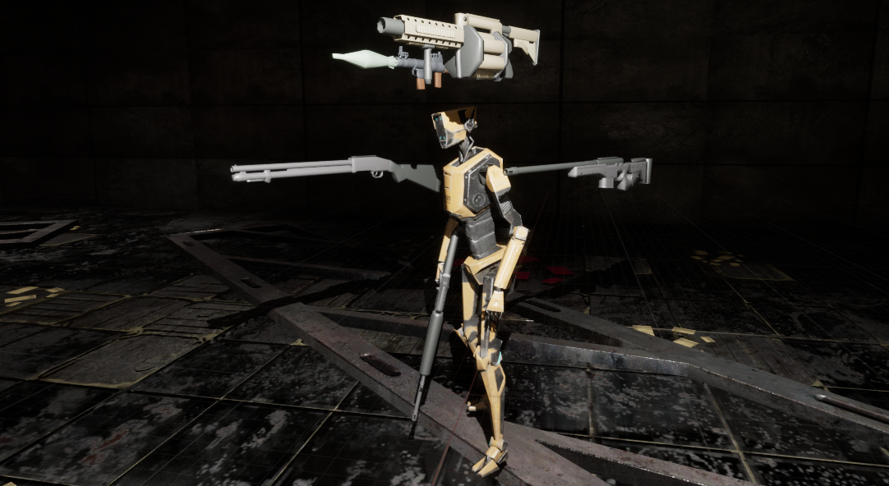

다양한 무기로 구역을 돌파하는 액션 로그라이크 TPS. 6인 팀에서 **전투 시스템 · 오브젝트 풀링 · UI 관리 · 포스트 프로세스** 를 맡았습니다.

<iframe class="video" src="https://www.youtube-nocookie.com/embed/6jrdc7jVilQ" title="Crawlescape 프로젝트 기록 영상" loading="lazy" allowfullscreen></iframe>

*프로젝트 전체 기록 영상*

| 장르 | 기간 | 담당 | 결과 | 환경 |
| --- | --- | --- | --- | --- |
| 액션 TPS · 로그라이크 | 2026.05 · 4주 · 6인 팀 | 전투 · 풀링 · UI · 포스트 프로세스 | 60fps 안정화 | UE 5.5 · C++ / BP |

*장비 · 전투 · 성장 → 처치 이벤트 → 미션, 풀링 · 스폰 지원*

*구역 진입 → 전투 · 성장 → 미션 → 출구, 시간이 지나면 전기장*

## 01 · 전투 — 데이터 드리븐 무기

<iframe class="video" src="https://www.youtube-nocookie.com/embed/LmYBKiMyngM" title="전투 시스템" loading="lazy" allowfullscreen></iframe>

*무기 교체와 사격*

*수치 · 강화 · 아이콘 · 장착 클래스가 전부 DataAsset 에*

*등 · 허리 · 양손 소켓 — 어디 붙일지도 데이터가 정한다*

공통 흐름은 C++, 무기별 동작만 BlueprintImplementableEvent — **C++ 수정 없이 무기 추가**.

## 02 · 오브젝트 풀링

| 단계 | 매번 Spawn / Destroy | 풀링 |
| --- | --- | --- |
| 생성 | 발사마다 생성 | 미리 확보해 꺼내 쓰기 |
| 반환 | Destroy → GC | 비활성화 후 반납 |
| 비용 | 발사 수에 비례 | 풀 크기만큼 고정 |

## 03 · UI 매니저

<iframe class="video" src="https://www.youtube-nocookie.com/embed/05jIXJ4GJK8" title="UI 시스템" loading="lazy" allowfullscreen></iframe>

*화면을 열고 닫는 흐름 — 레퍼런스 카운트가 0 이 될 때만 내려간다*

## 04 · UI 효과 — Dynamic Material Instance

<iframe class="video" src="https://www.youtube-nocookie.com/embed/gZ5CZWi2KTQ" title="히트 이펙트" loading="lazy" allowfullscreen></iframe>

*피격 순간의 화면 반응 — 연출은 머티리얼 안에서 끝난다*

## 트러블 슈팅

| 증상 | 원인 | 해결 |
| --- | --- | --- |
| 연사 중 프레임 하락 | SpawnActor / Destroy 반복 + GC | 풀링 컴포넌트로 재사용 |
| 패키징에서 일부 에셋 누락 | 경로로만 불러 참조가 없음 | Additional Asset Directories to Cook |

## 더 보기

- [포트폴리오 상세](https://geniedevice.github.io/Game-Project-Technical-Introduction/projects/crawlescape/) · [플레이 영상](https://www.youtube.com/watch?v=6jrdc7jVilQ)
