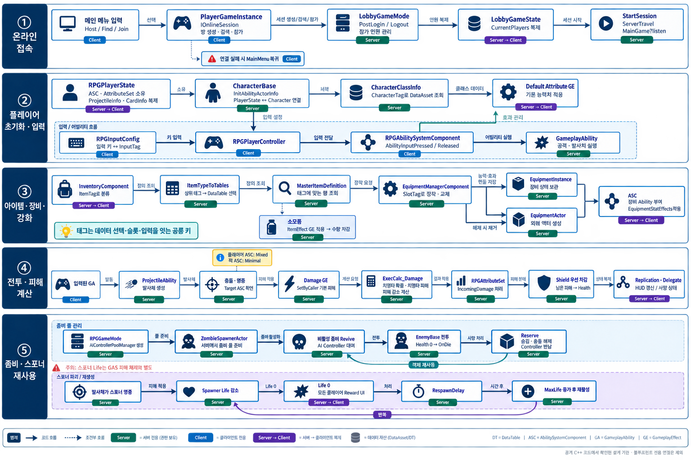
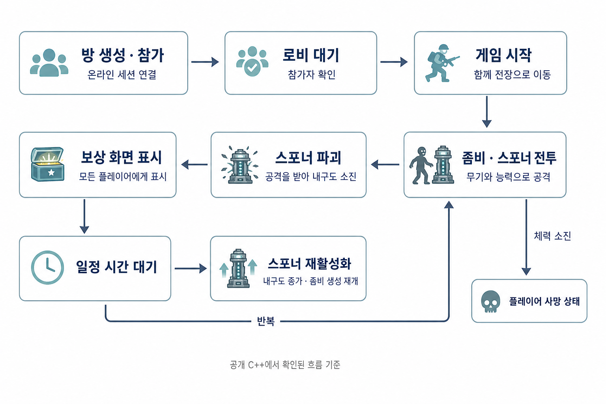
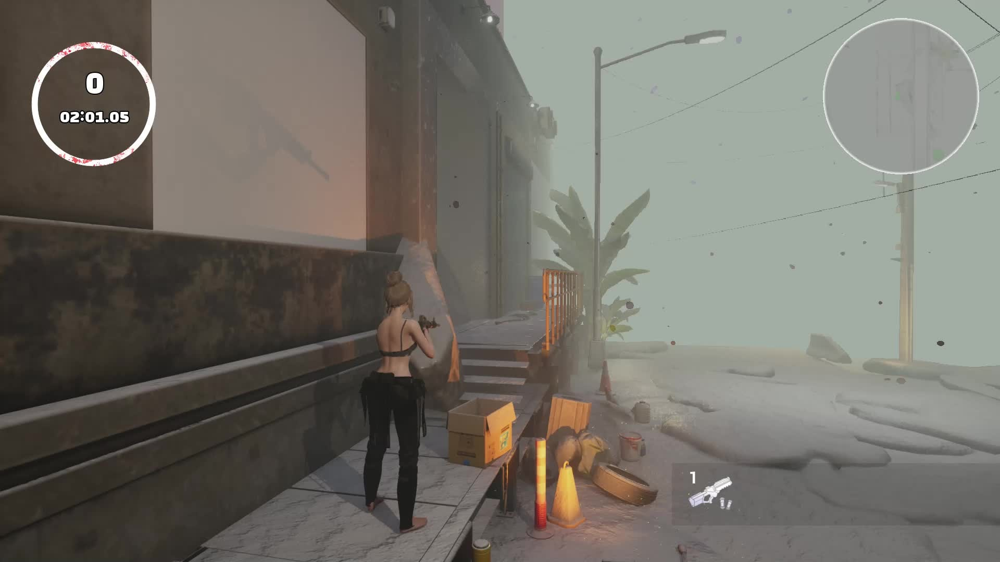
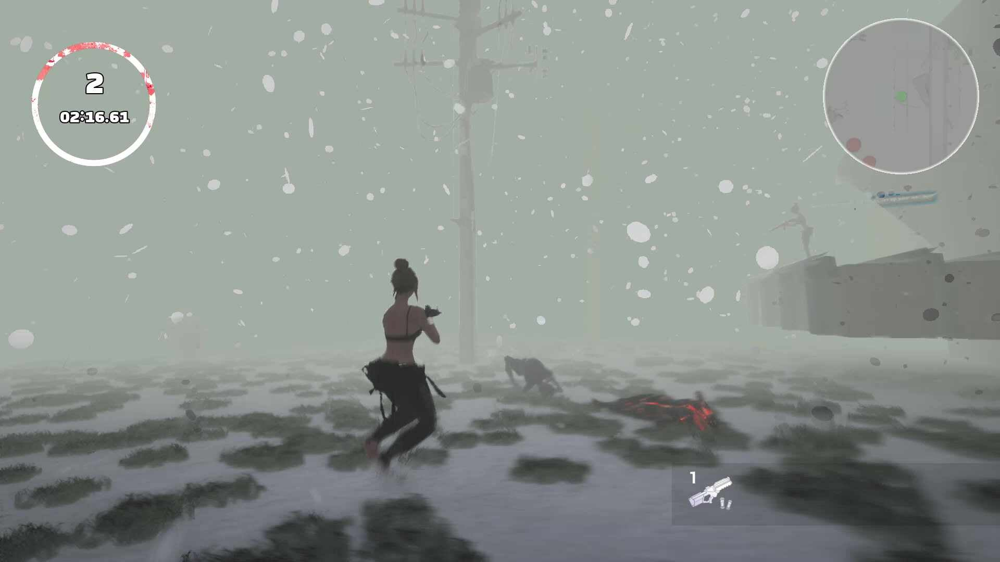
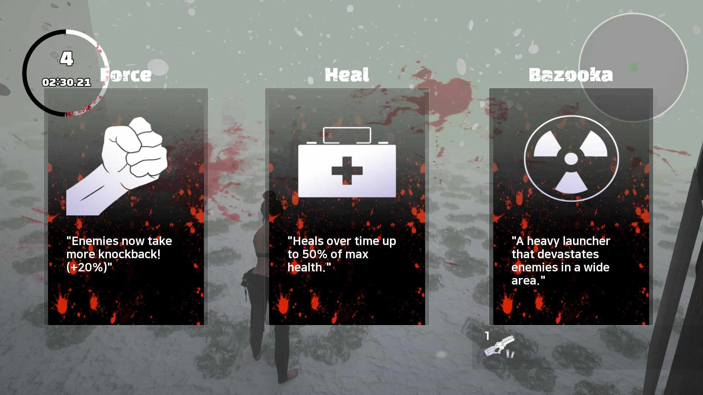

폐허 도시에서 좀비 웨이브를 함께 버티는 3D 멀티플레이 슈터. 혼자서 **네트워크 · 전투 · 아이템 · AI · UI** 전부를 설계했습니다.

<video class="video" src="/DevLog_Genie/media/destination/demo.mp4" poster="/DevLog_Genie/media/destination/demo.jpg" controls playsinline preload="none"></video>

*플레이 영상 — 웨이브를 버티며 폐허가 된 도시를 이동한다*

| 장르 | 기간 | 팀 | 담당 | 환경 |
| --- | --- | --- | --- | --- |
| 좀비 로그라이크 · 협동 | 2025.10 | 개인 | 전 영역 | UE 5 · C++ / BP · Steam |

*접속 → 초기화 · 입력 → 아이템 · 장비 → 전투 → 스포너 재사용, 서버 · 클라 구분*

*방 생성 → 전장 이동 → 전투 → 보상 → 스포너 재활성화*

## 01 · 네트워크 — 서버 권위

*안개 깔린 폐허 도시 — 좌상단은 남은 적 수와 웨이브 타이머*

*적 수 · 타이머는 서버가 쥐고 클라로 복제*

## 02 · 전투 · 아이템 · 성장

*웨이브 사이 카드 선택 — 넉백 · 지속 회복 · 신규 무기를 같은 틀에*

| 영역 | 접근 | 결과 |
| --- | --- | --- |
| 전투 | 모든 피해를 **ExecCalc** 한 곳으로 | 데미지 경로 단일화 |
| 아이템 | **FastArraySerializer** 델타 복제 | 바뀐 항목만 전송 |
| AI | 컨트롤러 **풀링** | 스폰 비용 제거 |

## 회고 — Lyra 에서 가져온 것

| 가져온 것 | 포기한 것 | 남은 숙제 |
| --- | --- | --- |
| InputTag — `키 → Tag → ASC → GA`, 무기 추가가 데이터 한 줄 | Experience · GameFeature (범위 초과) | 스포너 체력이 GAS 밖 — 피해 경로 두 갈래 |

> [!TIP]
> 남은 것은 기능이 아니라 **기준** 이었다. 감당할 수 있는 만큼만 가져온다.

## 더 보기

- [포트폴리오 상세](https://geniedevice.github.io/Game-Project-Technical-Introduction/projects/destination/) · [GitHub](https://github.com/Geniedevice/DESTINATION-OnlineSubSystem) · [개발 기록](https://blog.naver.com/startblack7/224034428520)
