《뱅!》의 정체 은닉 + 모든 카드가 **대실패 · 실패 · 성공 · 대성공** 으로 갈리는 확률 판정. 9인 팀에서 **카드 연출 · 시퀀스 · 렌더링 / 라이팅** 을 맡았습니다.

<video class="video" src="/DevLog_Genie/media/emberroad/card-play.mp4" poster="/DevLog_Genie/media/emberroad/card-play.jpg" controls playsinline preload="none"></video>

*한 턴의 카드 플레이 — 손패에서 골라 내고, 판정을 받고, 효과가 나간다*

| 장르 | 인원 | 기간 | 담당 | 환경 |
| --- | --- | --- | --- | --- |
| 마피아 카드 게임 | PvP 4~7 · PvE | 2026.07 – 10 · 9인 팀 | 카드 연출 · 시퀀스 · 렌더링 | UE 5.8 · C++ / BP |

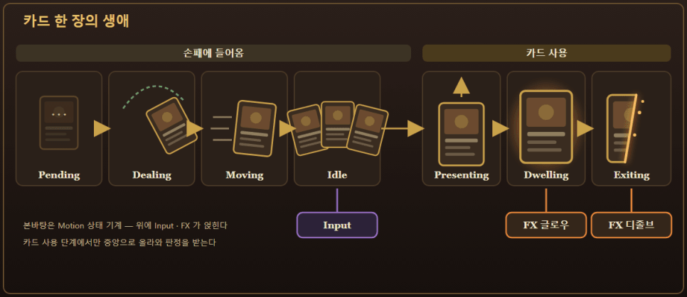

*카드 한 장의 생애 — 손패에 들어와 사용되고 사라지기까지*

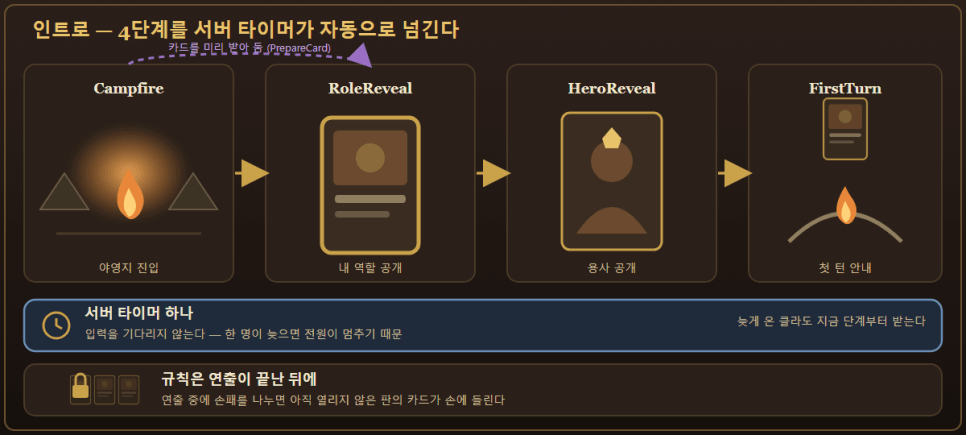

*인트로 — 서버 타이머 하나가 4단계를 넘긴다*

## 01 · 카드 연출 — 효과 목록이 곧 연출 조합

<video class="video" src="/DevLog_Genie/media/emberroad/card-hover.mp4" poster="/DevLog_Genie/media/emberroad/card-hover.jpg" controls playsinline preload="none"></video>

*호버 — 카드가 들리고 이웃이 밀려난다*

<video class="video" src="/DevLog_Genie/media/emberroad/card-fly.mp4" poster="/DevLog_Genie/media/emberroad/card-fly.jpg" controls playsinline loop muted autoplay></video>

*드로우 — 덱에서 손패 자리로 날아든다*

카드 11종 × 판정 4단계 = 44가지를 손으로 만들지 않도록, **카드 효과 목록을 그대로 연출 프리미티브로 재생**합니다. 연출용 데이터를 따로 두면 반드시 어긋납니다.

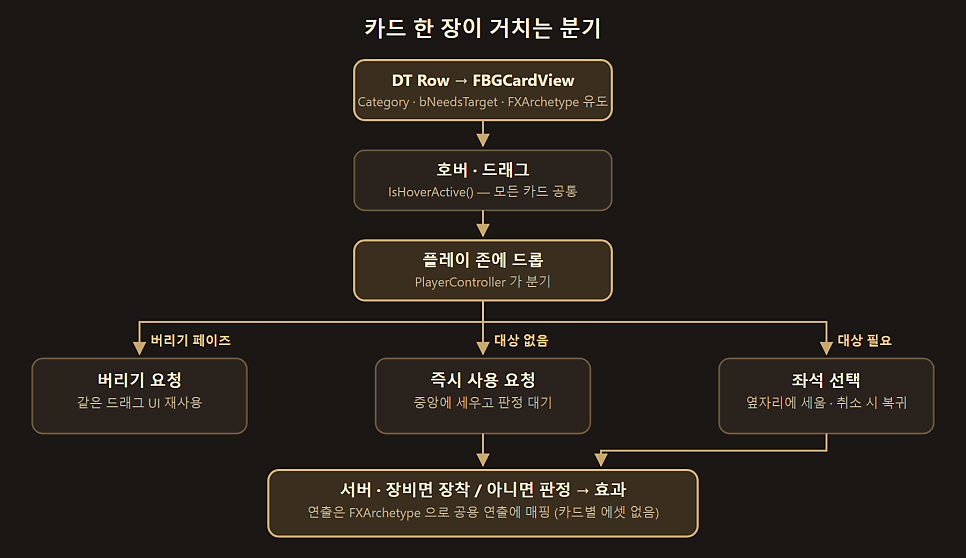

*카드 한 장이 거치는 분기 — 드롭 위치와 대상 필요 여부로 갈린다*

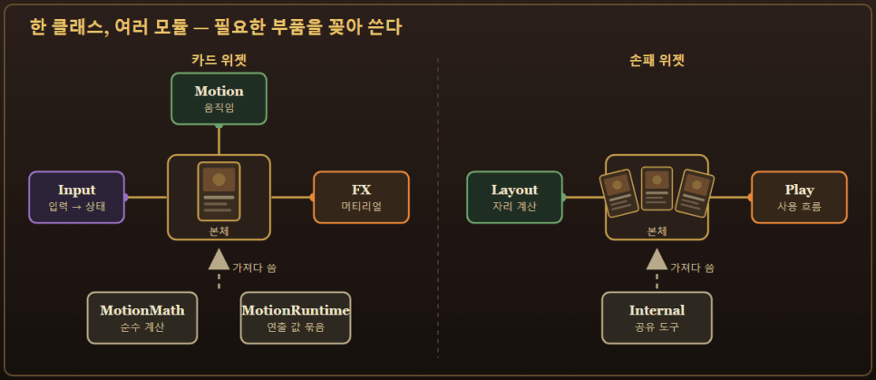

*Input · Motion · FX — 한 클래스를 성격별 모듈로*

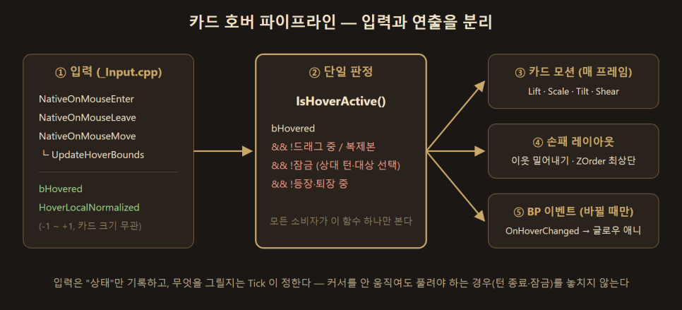

*입력은 상태만 기록, 그리기는 Tick 이 정한다*

## 02 · 머티리얼 — 판정 글로우와 퇴장 디졸브

<video class="video" src="/DevLog_Genie/media/emberroad/dissolve-attack.mp4" poster="/DevLog_Genie/media/emberroad/dissolve-attack.jpg" controls playsinline preload="none"></video>

*공격 — 뒤로 갈수록 빠르게 타며 잔불이 흩날린다*

<video class="video" src="/DevLog_Genie/media/emberroad/dissolve-heal.mp4" poster="/DevLog_Genie/media/emberroad/dissolve-heal.jpg" controls playsinline preload="none"></video>

*회복 — 같은 머티리얼, 잔불 없이 고르게*

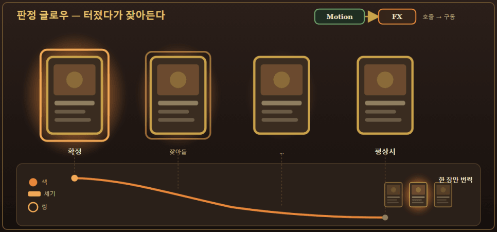

*판정 글로우 — 터졌다가 잦아든다*

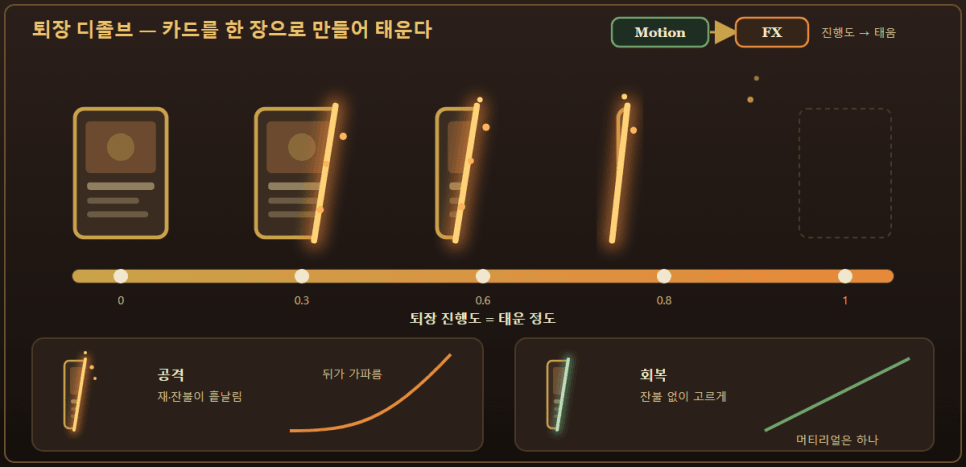

*퇴장 디졸브 — 진행 곡선만 다르다*

C++ → BP Tick → **위젯 애니메이션** 으로 세 번 옮겼습니다. 기준은 *눈으로 보면서 다듬을 수 있는가* 였습니다.

## 03 · 엔딩 — 진영별 세 가지

<video class="video" src="/DevLog_Genie/media/emberroad/ending-collapse.mp4" poster="/DevLog_Genie/media/emberroad/ending-collapse.jpg" controls playsinline preload="none"></video>

*무너진 왕국 — 무법자 승리. Chaos Destruction 캐시로 성이 무너진다*

<video class="video" src="/DevLog_Genie/media/emberroad/ending-dawn.mp4" poster="/DevLog_Genie/media/emberroad/ending-dawn.jpg" controls playsinline preload="none"></video>

*지켜낸 새벽 — 보안관 승리*

<video class="video" src="/DevLog_Genie/media/emberroad/ending-throne.mp4" poster="/DevLog_Genie/media/emberroad/ending-throne.jpg" controls playsinline preload="none"></video>

*빼앗긴 왕좌 — 배신자 승리*

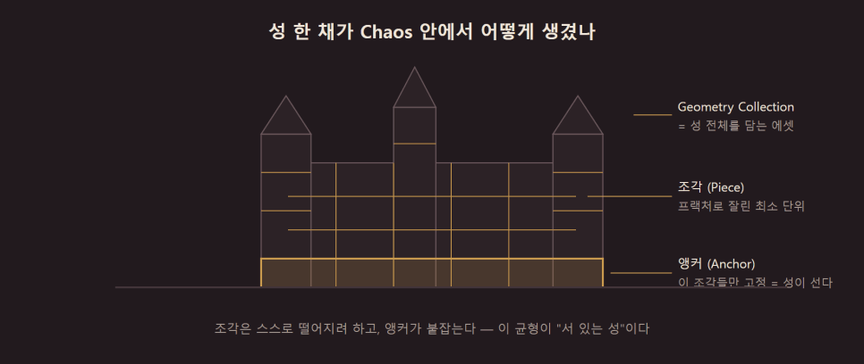

*조각은 떨어지려 하고, 앵커가 붙잡는다*

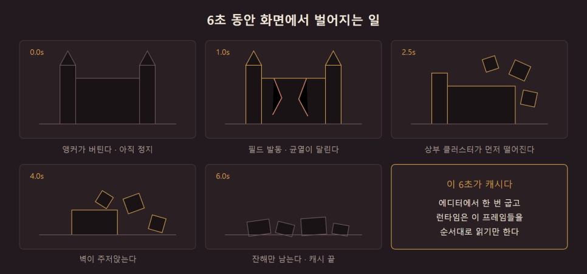

*6초를 에디터에서 굽고, 런타임은 읽기만*

## 04 · 시퀀스 — 서버가 단계를 들고 있다

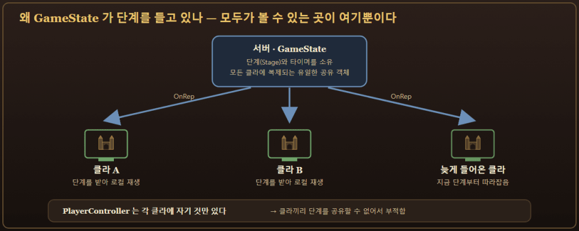

*단계만 복제하고 영상은 각자 로컬 재생 — 늦게 들어와도 지금 단계부터*

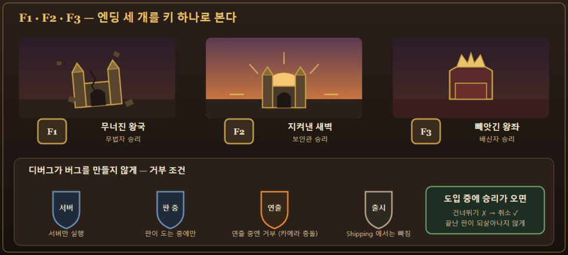

*엔딩 셋을 키 하나로 확인 — 서버 · 판 진행 중 · Shipping 제외 조건*

## 05 · 라이팅 — 무엇을 끌까부터

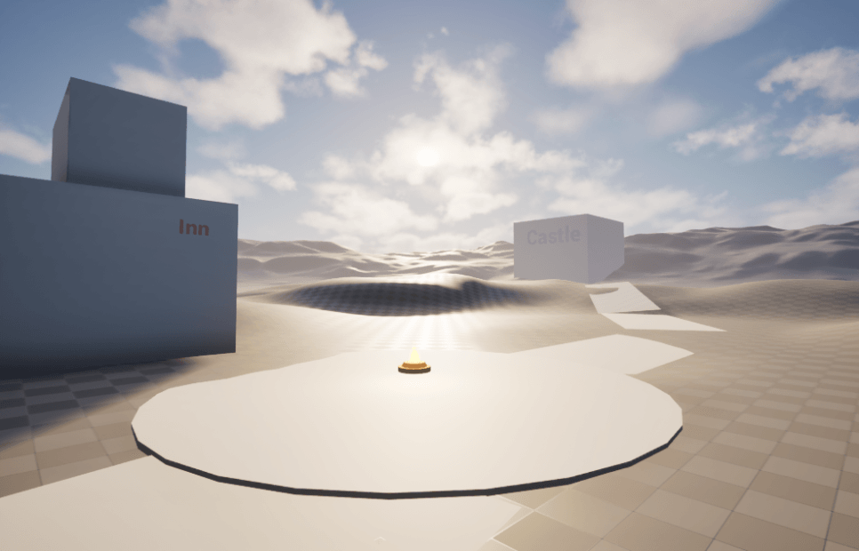

*전 — 실사 프리셋 그대로*

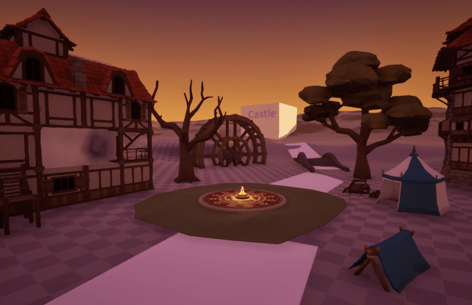

*후 — Lumen off + 노을 3레이어*

## 트러블 슈팅

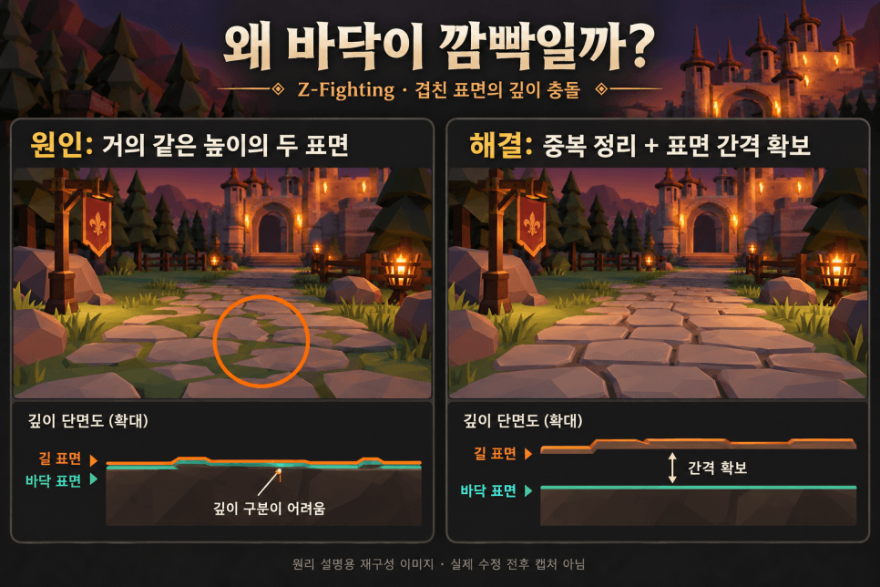

*바닥 깜빡임 ① — 겹친 표면을 정리하고 간격 확보*

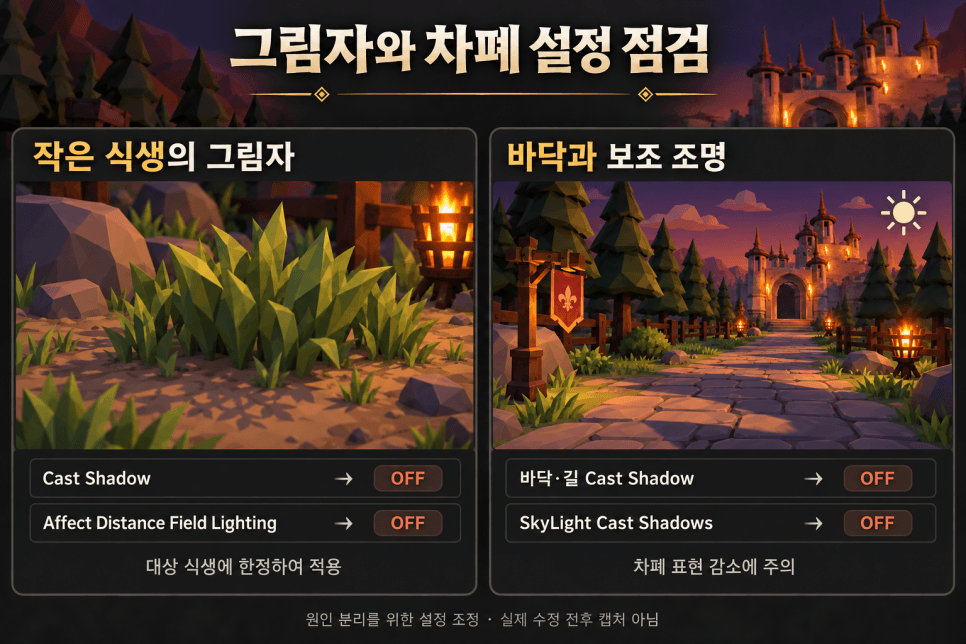

*바닥 깜빡임 ② — 작은 식생 · 바닥의 그림자 끄기*

| 증상 | 원인 | 해결 |
| --- | --- | --- |
| 바닥 · 길 · 잡초 깜빡임 | Z-Fighting + 식생 그림자 + 광원 반사, **셋** | 표면 분리 · 그림자 off · Specular 낮춤 |
| 실사 느낌 · 외곽선 안 나옴 | Lumen 등 실사 설정, AA off, `r.CustomDepth=1` | Lumen off · TSR · `r.CustomDepth=3` |
| 연출 단계가 클라마다 어긋남 | 클라마다 도는 타이머 | 서버 타이머 하나 + GameState 단계 복제 |

## 더 보기

- [포트폴리오 상세](https://geniedevice.github.io/Game-Project-Technical-Introduction/projects/emberroad/)
- 개발 기록: [Primitive 조합 연출](https://blog.naver.com/startblack7/224369187359) · [카드 연출(DMI)](https://blog.naver.com/startblack7/224370473451) · [로우폴리 라이팅](https://blog.naver.com/startblack7/224391284637) · [배경 깜빡임](https://blog.naver.com/startblack7/224416393147) · [붕괴 시뮬레이션](https://blog.naver.com/startblack7/224426329189) · [인트로/엔딩 시퀀스](https://blog.naver.com/startblack7/224433425791) · [카드 연출 모듈화](https://blog.naver.com/startblack7/224434348874)
