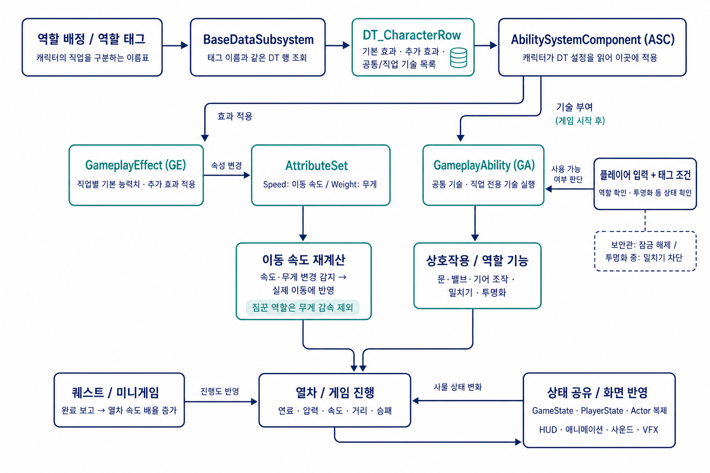
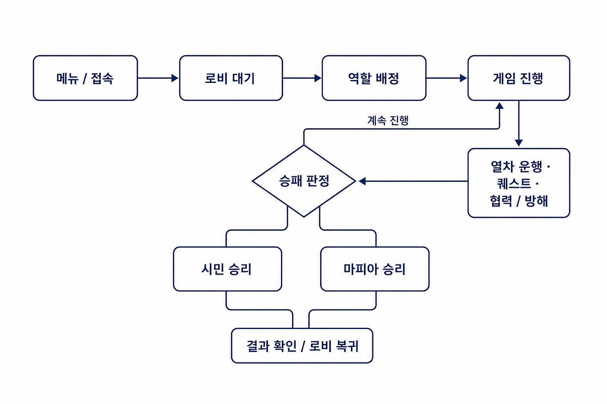
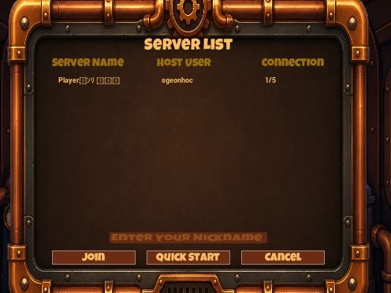
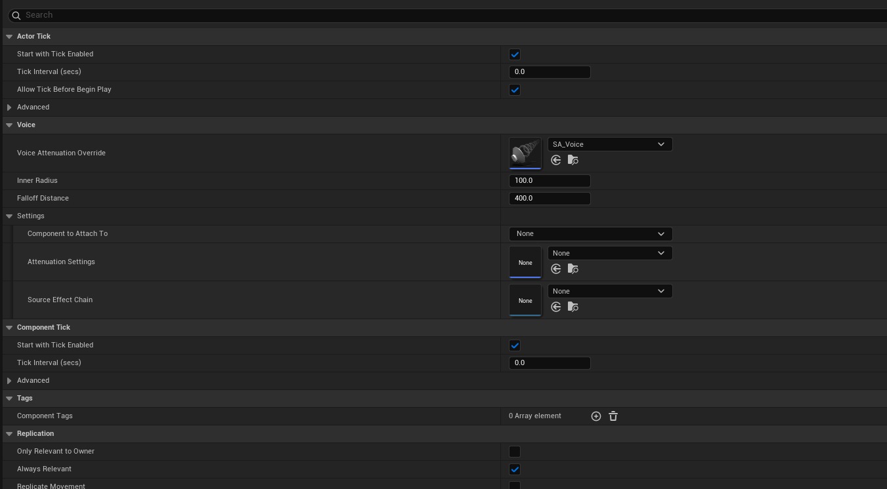
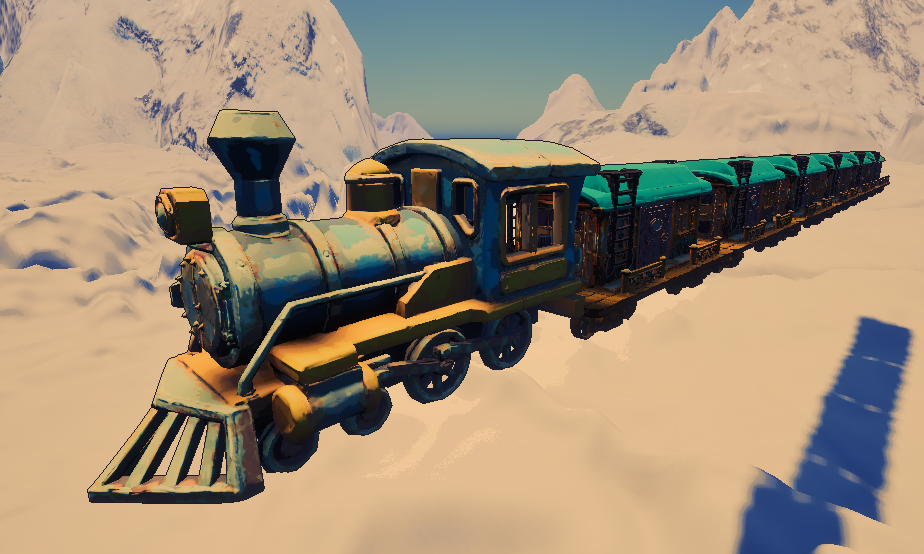
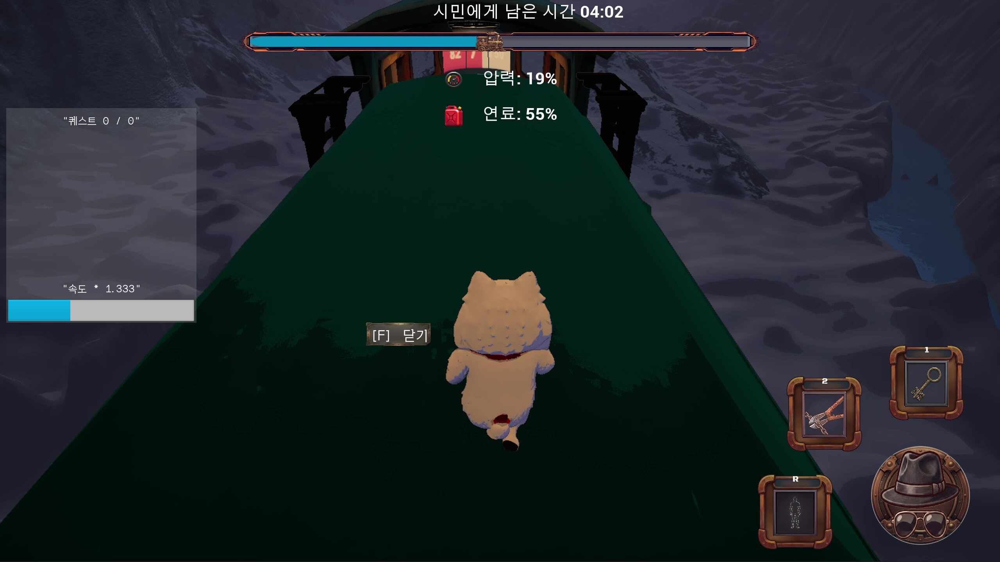
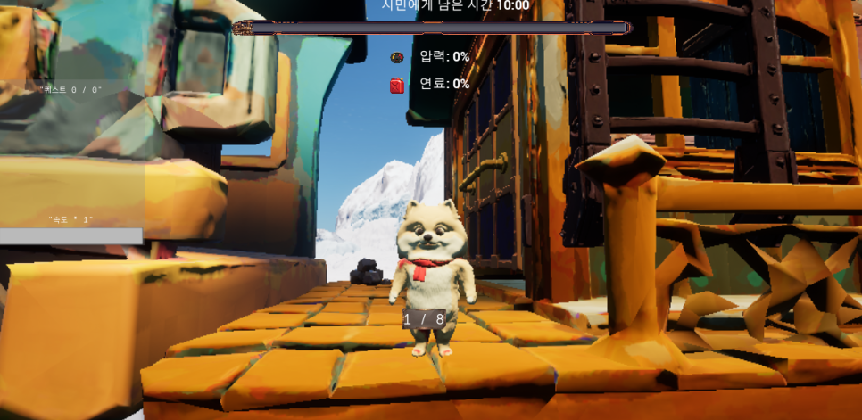
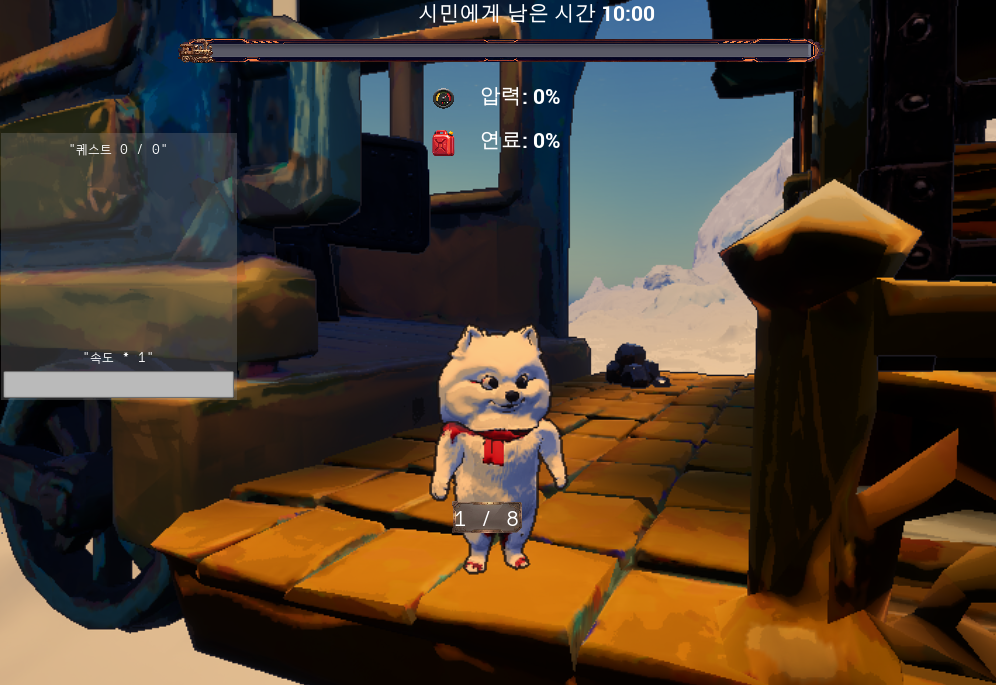
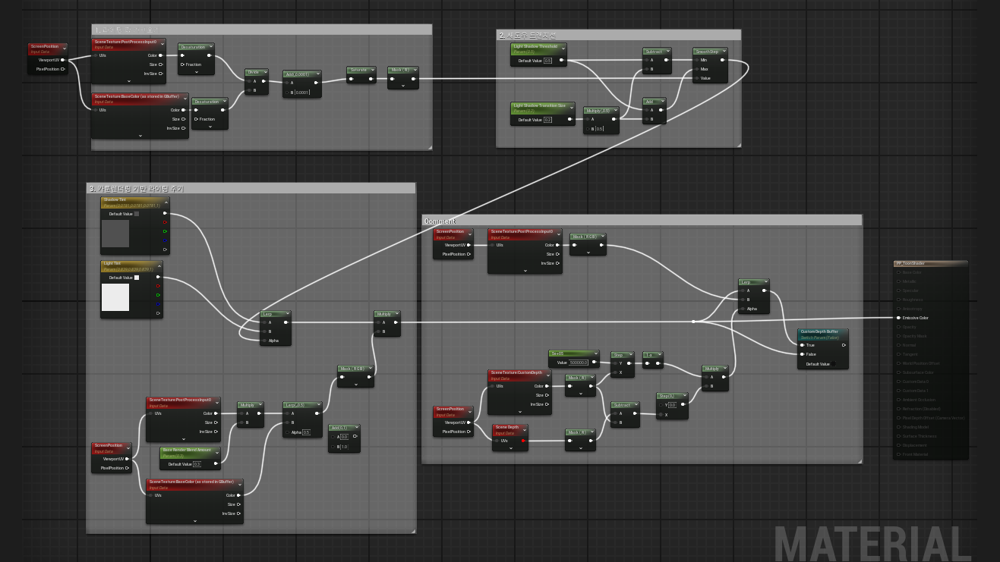

달리는 증기기관차 위, 다섯 명이 벌이는 10분간의 심리전. 5인 팀에서 **네트워크 · 보이스 · 열차 시스템 · 렌더링 / UI** 를 맡았습니다.

<iframe class="video" src="https://www.youtube-nocookie.com/embed/d1UV0k-tygk" title="Gears of Deceit 순찰자 시점 플레이" loading="lazy" allowfullscreen></iframe>

*순찰자 시점 플레이 — 열차 안을 돌며 다른 플레이어와 마주치는 한 판*

| 장르 | 인원 · 한 판 | 기간 | 담당 | 환경 |
| --- | --- | --- | --- | --- |
| 소셜 디덕션 파티 액션 | 5인 · 10분 | 2026.06 – 07 · 5인 팀 | 네트워크 · 열차 · 렌더링 / UI | UE 5 · C++ / BP · Steam |

*역할 태그로 DT 행을 찾아 GE · GA 를 ASC 에 붙인다*

*접속 → 로비 → 역할 배정 → 운행 · 퀘스트 · 방해 → 승패*

## 01 · 네트워크 — Steam OSS 세션

<iframe class="video" src="https://www.youtube-nocookie.com/embed/XhcKvdL2alY" title="세션 흐름" loading="lazy" allowfullscreen></iframe>

*방 생성 → 검색 → 참가 → 로비 대기*

*필터 전 — 남의 방이 깨진 이름으로 섞인다*

BUILD_ID 서명 필터로 **우리 빌드의 방만** 통과시켰습니다.

## 02 · 보이스 — 거리 감쇠 · 채널 격리

<iframe class="video" src="https://www.youtube-nocookie.com/embed/JYJum1TzH1E" title="근접 보이스" loading="lazy" allowfullscreen></iframe>

*거리에 따라 줄고, 채널이 갈리면 안 들린다*

*Inner Radius 100 · Falloff 400 — 대화가 성립하는 거리*

> [!IMPORTANT]
> 소셜 디덕션에서 들리는 범위는 편의 기능이 아니라 **규칙** 이다.

## 03 · 열차 — 스플라인 주행과 탑승 유지

<iframe class="video" src="https://www.youtube-nocookie.com/embed/NLYeQMLkxEc" title="열차 주행" loading="lazy" allowfullscreen></iframe>

*스플라인을 따라 달리는 열차 — 주행 중 흔들림까지*

*설원을 가로지르는 베헤모스*

*바닥이 계속 움직이는 지붕 위 — `SetBase()` 로 탑승 유지*

## 04 · 렌더링 — 툰 셰이딩과 외곽선

<iframe class="video" src="https://www.youtube-nocookie.com/embed/Lvm8ebl0OSE" title="툰 셰이딩" loading="lazy" allowfullscreen></iframe>

*셀 셰이딩 화면과 상호작용 외곽선*

*전 — 색이 뭉치고 경계가 묻힌다*

*후 — 명암이 단을 이루고 실루엣이 선다*

*밝기 → SmoothStep 으로 단 끊기 → 색 입히기 → CustomDepth 차이로 외곽선*

## 트러블 슈팅

| 증상 | 원인 | 해결 |
| --- | --- | --- |
| 세션 목록이 비거나 남의 방 · 유령 방 | 종료 경로 누락, 공용 AppID | LoadMainMenu 연결 · 검색 워치독 · BUILD_ID 필터 |
| 죽은 사람 목소리가 산 사람에게 | 채널이 생사를 몰랐음 | 생사 · 공간 기준 채널 재배정 |
| 열차 위 캐릭터가 밀려 떨어짐 | 발판 이동 벡터를 못 받음 | `SetBase()` 강제 바인딩 |

## 더 보기

- [포트폴리오 상세](https://geniedevice.github.io/Game-Project-Technical-Introduction/projects/gears-of-deceit/) · [GitHub](https://github.com/NBcampUnrealTrack/8th-Team4-CH4-Project) · [플레이 영상](https://www.youtube.com/watch?v=d1UV0k-tygk)
